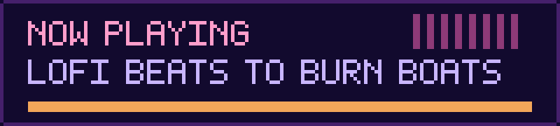
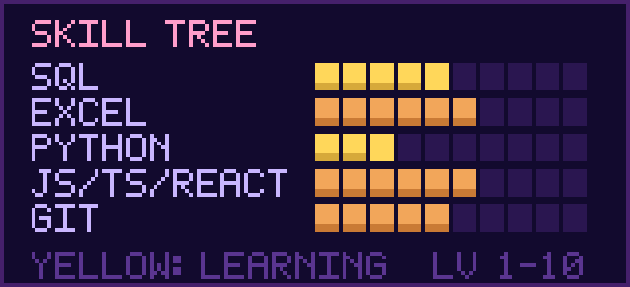

 

## ▶ PLAYER 1

Hi, I'm **Victor**. I work in IT support in Brasília, turning messy operational data into something people can actually decide with, and I'm building my way into **Data Engineering**.

- ▸ **Now:** IT assistant, writing SQL queries, building Excel reports and automating daily operations
- ▸ **Before:** front-end development with React and JavaScript
- ▸ **Leveling up:** Python (pandas), SQL and data pipelines
- ▸ **Goal:** join global, remote-first teams and work on projects that cross borders

Lofi beats, 8-bit nostalgia and a little melancholy keep me company while I learn.

## ▶ SKILL TREE

  

## ▶ COMPLETED QUESTS (PROJECTS)

| Quest | Stack | Links |
|---|---|---|
| **SAMA Shift Fulfillment Analysis** Which stores are fully staffed, where do freelancers drop out, and where are the staffing bottlenecks? | SQL (SQLite) · Excel | [Code & data](https://github.com/Victorjota-web/sama-operational-data-analysis) |
| **Student Management Painel** Internal dashboard to manage gym students, track active/inactive status and monthly enrollments and cancellations | React · JavaScript · CSS3 | [Demo](https://student-management-painel.vercel.app/) · [Code](https://github.com/Victorjota-web/student-management-painel) |
| **Trial Class Scheduling System** Multi-step app to schedule gym trial classes, with form validation (Zod) and workout recommendations | React · JavaScript · CSS3 | [Demo](https://allpfit-agendamento.vercel.app) · [Code](https://github.com/Victorjota-web/allpfit-agendamento) |

**Side quest in progress:** Python (pandas) for data analysis.

## ▶ MAIN QUEST

Move from IT support into **Data Engineering**: pipelines, clean data models and numbers people trust.

> *"Burn the boats. Focus on daily progress."*
>  Queime os barcos. Foque no progresso diário.

**INSERT COIN TO CONTINUE ▮**

